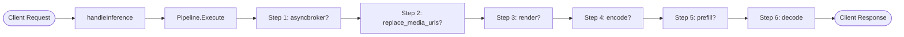
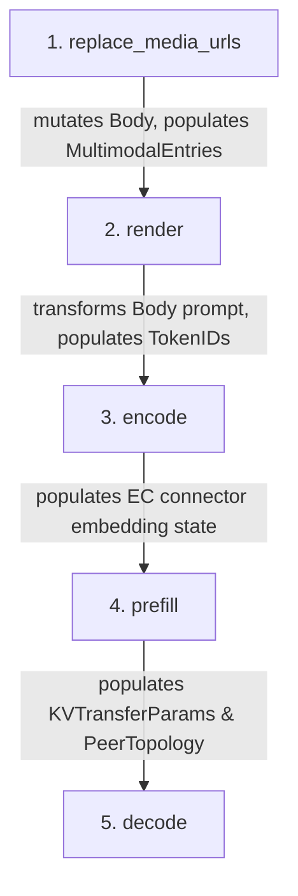
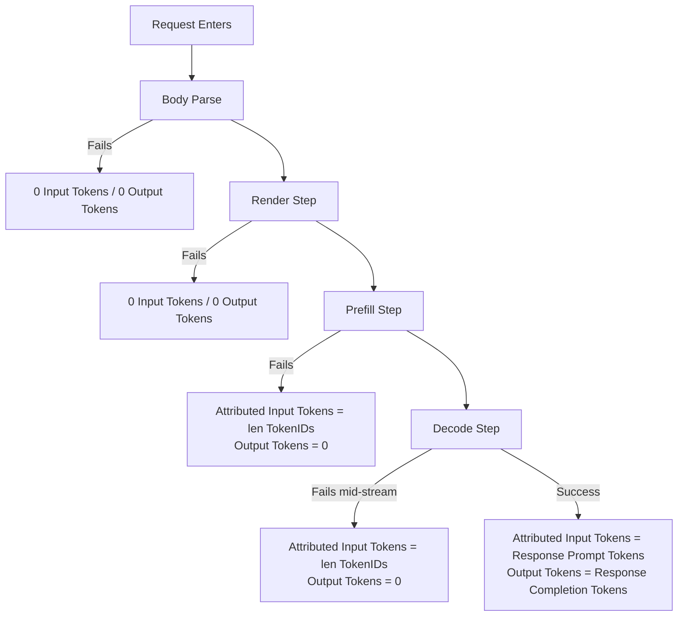
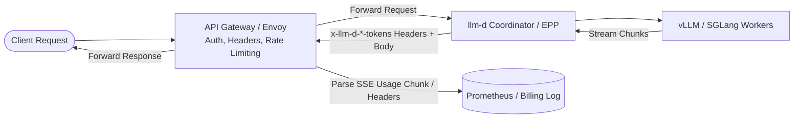
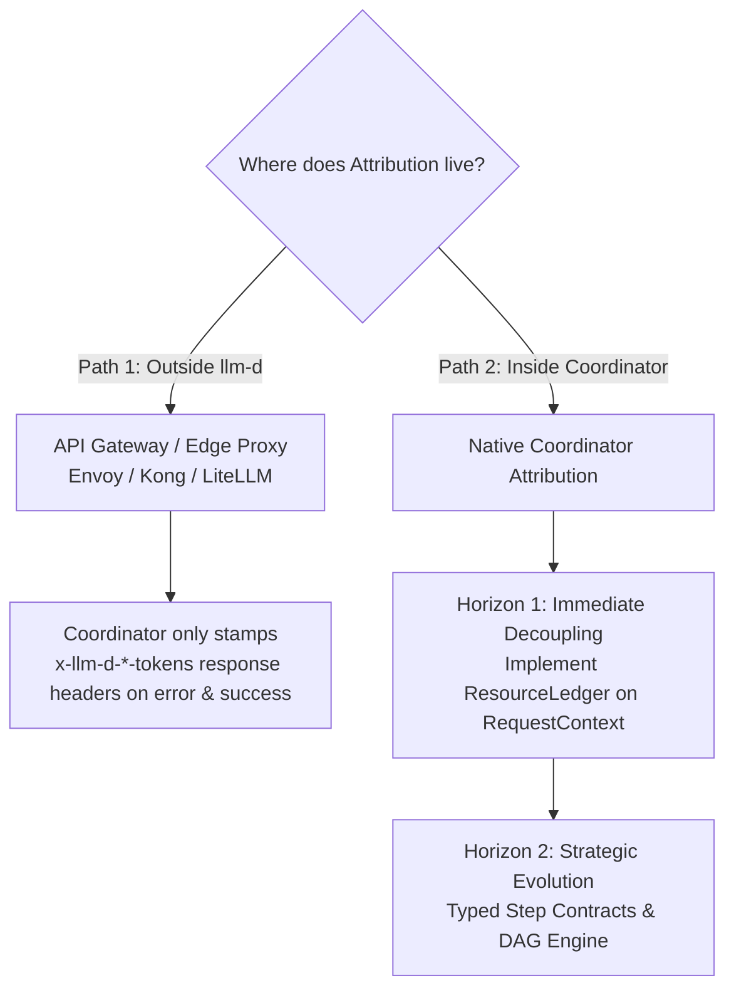

# Decoupling Coordinator Metrics and Telemetry from Pipeline Topology

**Status**: Draft  
**Authors**: Sima Nadler (*IBM*)  
**Related Proposals**: [`coordinator-request-attribution-metrics.md`](coordinator-request-attribution-metrics.md)

---

## 1. Summary

The coordinator executes inference requests via a configurable step pipeline (`render`, `encode`, `prefill`, `decode`, `conditional-decode`, etc.). While pipeline assembly is syntactically dynamic (configured via YAML and loaded through a step registry), the underlying engine operates on a **Stateful Blackboard Pattern** where steps communicate via mutable side effects on a shared `RequestContext`.

**Crucially, this architectural problem exists regardless of request attribution:**
1. **Functionally**, steps already have strict implicit ordering dependencies (`replace_media_urls` $\rightarrow$ `render` $\rightarrow$ `encode` $\rightarrow$ `prefill` $\rightarrow$ `decode`), fixed terminal positions, and positional builder constraints.
2. **Observability-wise**, existing core metrics in `pipeline.go` and `handlers.go` already deduce what happened by querying hardcoded step names (`executed["render"]`) and inspecting intermediate context artifacts (`TokenIDs`, `EncodeFanout`).
3. **Attribution-wise**, financial accounting, chargeback, and per-request billing make this structural debt significantly more visible because they require assembling a single, authoritative terminal record combining identity, input work, output work, and failure classification across heterogeneous pipeline topologies.

This document frames the architectural reality of the coordinator, explains why attribution exposes this problem, and evaluates **two primary, independent architectural tracks**:

* **Track 1: External Attribution (Outside llm-d / Gateway Tier)**: Implement request attribution and billing entirely outside the coordinator at the API Gateway / Ingress tier (e.g. Envoy, Kong AI Gateway, LiteLLM Proxy). The only required coordinator change is stamping processed token counts (`x-llm-d-prompt-tokens`, `x-llm-d-completion-tokens`) on response headers across both successes and errors.
* **Track 2: Internal Pipeline Decoupling via Resource Ledger (Two Horizons)**: Improve the coordinator pipeline with or without relation to attribution:
  * **Horizon 1 (Immediate / In-Scope)**: Introduce a **Resource Ledger** on `RequestContext` to decouple metrics and telemetry from pipeline internals without requiring a full pipeline rewrite.
  * **Horizon 2 (Strategic / Future Evolution)**: Evolve the coordinator from a blackboard architecture to an explicit Typed Dataflow / DAG pipeline for complex agentic loops and branching topologies.

*(Note: Track 1 and Track 2 are completely independent—external attribution can be adopted without internal pipeline changes, and the Resource Ledger improves coordinator observability whether attribution is enabled or not).*

---

## 2. The Root Architectural Reality: The Stateful Blackboard

The coordinator pipeline was intended to provide a modular, pluggable architecture:



While individual steps implement a clean `Step` interface (`Execute(ctx, reqCtx)`), they are not isolated units of execution. Instead, the pipeline operates as a **Stateful Blackboard**, where `RequestContext` acts as a shared mutable memory space.

### 2.1 Implicit Sequential Data Contracts

Steps do not pass typed inputs and outputs directly to each other. Instead, downstream steps rely on specific fields being mutated on `RequestContext` by upstream steps:



* **`replace_media_urls` $\rightarrow$ `render`**: `replace_media_urls` replaces remote media URLs with local file descriptors in `reqCtx.Body` and seeds `reqCtx.MultimodalEntries`. `render` explicitly verifies that `MultimodalEntries` exists and matches the modality sequence in `reqCtx.Body`.
* **`render` $\rightarrow$ `encode` / `prefill`**: `render` replaces string prompts in `reqCtx.Body` with `reqCtx.TokenIDs`. `prefill` expects this tokenized structure when `use_openai_format: false`.
* **`encode` $\rightarrow$ `prefill`**: `encode` runs fanout for multimodal inputs, populating embedding cache state (`ECConnector`) that `prefill.buildPrefillBody()` reads.
* **`prefill` $\rightarrow$ `decode`**: `prefill` captures `reqCtx.PeerTopology` and `reqCtx.KVTransferParams` from upstream worker responses. `decode` requires these exact fields to inject the `x-llm-d-peer-topology` header and KV transfer payload into the downstream decode worker.

### 2.2 Terminal HTTP Response Ownership (`ReverseProxy`)

In `decode.go` and `conditional_decode.go`, the step uses Go's `httputil.ReverseProxy` to stream HTTP chunks directly to the client's `http.ResponseWriter`.

* Because HTTP status headers and stream chunks are committed to the client during this step, **`decode` must always be the final step**.
* A post-processing or validation step placed after `decode` cannot alter response headers or return an HTTP error status code (as the HTTP stream is already committed and closed).

### 2.3 Positional Enforcement in the Pipeline Builder

Because steps have strict positional prerequisites, the pipeline constructor ([`pkg/coordinator/pipeline/builder/builder.go`](../../pkg/coordinator/pipeline/builder/builder.go:38)) must enforce explicit ordering rules:

```go
// builder.go
func validatePipeline(p config.PipelineConfig) error {
    for i, s := range p.Steps {
        // Enforces asyncbroker MUST be position 0
        if s.Type == asyncbroker.StepName && i > 0 {
            return fmt.Errorf("the %q step must be the first pipeline step, found it at position %d", asyncbroker.StepName, i+1)
        }
    }
    // Enforces render is present if tokens-in format is used
    if !p.UseOpenAIFormat {
        // requires RenderStepName ...
    }
}
```

* **`asyncbroker`**: Must be step 0 because queued requests must be captured verbatim before any subsequent step mutates `reqCtx.Body`.
* **Tokens-in (`use_openai_format: false`)**: Rejects pipelines without `render` because downstream steps cannot operate without token IDs.

### 2.4 Control Flow Short-Circuits (`ErrPipelineDone`)

`conditional_decode` checks for a local KV cache hit on the decode worker:
* On a cache hit, it executes decode immediately and returns `pipeline.ErrPipelineDone`.
* `pipeline.Execute` intercepts `ErrPipelineDone` and aborts all remaining steps cleanly.
* This logic strictly assumes `conditional_decode` is positioned **before** `prefill` and `decode` in the pipeline.

### 2.5 Telemetry as the First Symptom of the Blackboard Pattern

Because the pipeline does not have explicit dataflow or resource reporting interfaces, the telemetry layer was forced to inspect the blackboard post-execution:

1. **Hardcoded Step Identity Checks**: In [`pkg/coordinator/pipeline/pipeline.go`](../../pkg/coordinator/pipeline/pipeline.go:198), the cleanup defer queries whether `"render"` ran:
   ```go
   if executed["render"] {
       coordmetrics.RecordRequestInputTokens(reqCtx.Model, len(reqCtx.TokenIDs))
   }
   coordmetrics.RecordEncodeSubrequests(reqCtx.Route, reqCtx.EncodeFanout)
   ```
2. **Brittle Path Classification**: In [`pkg/coordinator/metrics/classify.go`](../../pkg/coordinator/metrics/classify.go), `classifyExecutionPath` matches fixed permutations of step names (`"render+encode+prefill+decode"`, `"render+decode"`). Adding a new step (e.g. moderation, routing classifier, guardrail) breaks path classification.

---

## 3. Why Attribution Makes This a Much Bigger Problem

While operational latency metrics can tolerate approximate heuristics and missing data points, **request attribution is used for financial chargeback, budgeting, and invoicing**. Attribution amplifies the blackboard coupling problem into a critical architectural friction point.

### 3.1 Single Terminal Convergence Requirement

Operational metrics can be emitted incrementally across steps. Attribution, however, requires a **single, consolidated terminal record** per request (for Prometheus counters and structured JSON billing logs).

This terminal record must combine:
* **Identity**: `(tenant_id, user_id, workload_id)` resolved at entry.
* **Input Work**: Prompt tokens consumed on GPU.
* **Output Work**: Completion tokens generated on GPU.
* **Outcome**: Success vs. specific failure classification.

Emitting this from the outer `handleInference` defer forces the outer handler to reconstruct the entire execution narrative across all stages.

### 3.2 Inconsistent Accounting Across Pipeline Topologies

Because prompt tokens were historically tied to `len(reqCtx.TokenIDs)` from `render`:

1. **Topology A (Render in Pipeline)**: Prompt tokens reflect the coordinator's tokenizer output.
2. **Topology B (Render-less / Worker Tokenization)**: Prompt tokens reflect the backend engine's `usage.prompt_tokens`.

These two numbers frequently diverge due to chat templates, special tokens, system prompt formatting, and multimodal token expansion. As a result:
* Identical requests served on different clusters bill differently depending on pipeline configuration.
* Reconfiguring a pipeline silently shifts customer invoices.

### 3.3 Failure State Deducing

When an inference request fails, the outer defer must determine how much GPU work was consumed prior to failure:



To implement this decision tree, the outer handler has to inspect:
* Did `UsageCaptured` get set? $\rightarrow$ Take response usage.
* If not, is `len(reqCtx.TokenIDs) > 0`? $\rightarrow$ Assume prefill ran and attribute `len(TokenIDs)`.
* If not $\rightarrow$ Assume failure happened before GPU compute.

This logic makes strict assumptions about pipeline order:
* It assumes tokenization always precedes prefill.
* It assumes decode is always the final step.
* It assumes prefill failures happen after `TokenIDs` are populated.

If the pipeline evolves (e.g. speculative decoding loops, multi-candidate verification, prompt rewriting, or retries), this deduction logic completely breaks down.

---

## 4. Architectural Alternatives

To resolve this coupling, the coordinator needs an abstraction that separates **what steps execute** from **how resource consumption is accumulated and reported**.

---

### Change 1: Pure Black-Box (Response-Only / Gateway-Level) Accounting

Treat the entire coordinator pipeline as an opaque black box for token accounting. Attribution and cost tracking can live either at the coordinator boundary or **entirely outside llm-d in an API Gateway** (e.g. Envoy WASM filter, Kong AI Gateway, LiteLLM Proxy, Portkey).



#### 4.1 Returning Token Metrics on Errors

A common limitation of standard black-box accounting is losing visibility into GPU prefill work when a request fails late in execution. However, this can be addressed by ensuring **token metrics processed up to the point of failure are returned alongside error responses**:

```http
HTTP/1.1 500 Internal Server Error
x-llm-d-prompt-tokens: 4096
x-llm-d-completion-tokens: 0
x-llm-d-error-code: upstream_prefill_timeout
Content-Type: application/json

{
  "error": { "message": "Upstream worker timed out during prefill", "type": "server_error" }
}
```

Mechanisms to pass token usage with errors:
* **Mechanism A: Dedicated HTTP Response Headers (Recommended)**: The coordinator stamps `x-llm-d-prompt-tokens` and `x-llm-d-completion-tokens` on *all* responses (200, 4xx, 5xx). An external Gateway or proxy reads these headers directly without needing to parse error JSON bodies. Standard client SDKs remain unaffected.
* **Mechanism B: Structured Error JSON Payload**: Include a `usage` block inside the standard error payload (`{"error": {...}, "usage": {"prompt_tokens": 4096, ...}}`).
* **Mechanism C: Terminal SSE Error Chunks**: For streaming responses that fail mid-generation, emit a final SSE error event carrying usage before closing the stream (similar to Anthropic `message_delta` error events).

#### 4.2 Inherent Edge Case: Ungraceful Disconnects & Crashes
If a GPU node experiences a hard kernel panic, pod `SIGKILL` (OOM), or an abrupt TCP reset (`RST`), no HTTP headers or payload can cross the wire. In this rare scenario, external gateways will see 0 tokens, and only internal coordinator logs/traces retain the partial prefill count.

#### 4.3 Trade-Offs
* **Pros**:
  * **Zero Coupling**: Keeps llm-d strictly focused on inference orchestration; leaves identity and billing to API Gateway management tiers.
  * **Works Across All Deployments**: Operates identically whether llm-d is deployed with the Coordinator, in Sidecar-only mode, or as standalone vLLM.
  * **Header-Driven Billing**: With custom response headers, external gateways can accurately bill both successes and errors with zero body parsing overhead.
* **Cons**:
  * Requires an upstream Gateway tier capable of streaming SSE inspection and header extraction.
  * Ungraceful TCP aborts cannot be billed at the gateway level.

---

### Change 2: Resource Ledger Pattern (Recommended for Internal Coordinator Decoupling)

Instead of the outer handler inspecting raw step artifacts (`TokenIDs`, `UsageCaptured`, etc.), `RequestContext` encapsulates a generic **`ResourceLedger`**:

```go
type ResourceLedger struct {
    // InputTokens is the authoritative input count.
    InputTokens int
    // InputIsEstimated is true if InputTokens is based on local tokenization/prefill
    // rather than confirmed backend response usage.
    InputIsEstimated bool

    // OutputTokens is the confirmed completion count from the engine.
    OutputTokens int

    // UsageConfirmed indicates whether the terminal engine returned authoritative usage.
    UsageConfirmed bool

    // StepUsage records granular contributions per step name for audit/debug.
    StepUsage map[string]StepMetrics
}

type StepMetrics struct {
    Duration    time.Duration
    InputTokens int
    Items       int // e.g. media items, fanout subrequests
}
```

#### How Steps Interact with the Ledger

1. **`RenderStep` / Tokenizer**:
   ```go
   reqCtx.Ledger.RecordInputTokens(len(tokens), /* estimated = */ true)
   ```
2. **`EncodeStep`**:
   ```go
   reqCtx.Ledger.RecordStepMetric("encode", StepMetrics{Items: fanout})
   ```
3. **`DecodeStep` (Response Usage Parser)**:
   ```go
   // Authoritative response usage overwrites preliminary estimates:
   reqCtx.Ledger.RecordFinalUsage(parsed.Usage.PromptTokens, parsed.Usage.CompletionTokens)
   ```

#### Benefits
* **Zero Pipeline Knowledge in Handlers**: The outer `handleInference` defer simply queries `reqCtx.Ledger.InputTokens` and `reqCtx.Ledger.OutputTokens`.
* **Topology Independence**: Any pipeline configuration (render-first, worker-tokenized, cached, multi-step) writes into the ledger according to what actually ran.
* **Extensible**: New steps (e.g. guardrails, rerankers) can record their own consumption metrics without modifying pipeline defers.

---

---

## 5. Comparison Matrix

| Evaluation Dimension | Current Architecture | Change 1: Black-Box (Gateway / Headers) | Change 2: Resource Ledger (Recommended) | Pipeline Observers (Appendix A) | Step-Autonomous (Appendix B) |
|---|---|---|---|---|---|
| **Coupling to Pipeline Order** | **High** (Hard-wired) | **None** (Opaque / Edge Gateway) | **None** (Data abstraction) | **None** (Event-driven) | **None** (Distributed) |
| **Supports Non-Linear Pipelines (Loops/Branches)** | Poor | Excellent | Good | Excellent | Good |
| **Unified Request Log Line Support** | High (but fragile) | Excellent (via Gateway/Server) | Excellent | Excellent | Poor |
| **Failed Request Cost Attribution** | Partial (via heuristics) | High (via response headers) / None on TCP reset | High (Explicit tracking) | High (Event hooks) | High |
| **Implementation Location** | Coordinator defers | Gateway / Edge Proxy or Coordinator Edge | Coordinator (`reqCtx.Ledger`) | Coordinator runner | Coordinator steps |
| **Implementation Complexity** | Low | Minimal in llm-d (Low–Medium in Gateway) | Low–Medium | Medium | Medium |

---

## 6. Strategic Paths and Roadmap

To address these architectural tensions, the team can choose between two primary paths forward:



### Path 1: External Attribution (Gateway Tier)
If the deployment architecture already includes an API Gateway handling authentication, rate limiting, and client keys:
1. **Scope in llm-d**: Attribution code, header extraction, and tee parsers are not added to the coordinator.
2. **Coordinator Enhancement**: The coordinator stamps `x-llm-d-prompt-tokens` and `x-llm-d-completion-tokens` response headers on both successful and failed responses so the gateway can bill accurately.
3. **Internal Telemetry**: The coordinator can still adopt the `ResourceLedger` independently to clean up its existing `RecordRequestInputTokens` and `classifyExecutionPath` metrics.

### Path 2: Native Coordinator Attribution (Two-Horizon Roadmap)
If llm-d must provide self-contained, out-of-the-box request attribution:

#### Horizon 1 (Immediate / In-Scope)
1. **Implement `ResourceLedger` on `RequestContext`**:
   - Encapsulate token and work metrics within `reqCtx.Ledger`.
   - Update `render`, `encode`, and `decode` to report into the ledger.
2. **Decouple Outer Handlers & Defers**:
   - Have `handleInference` defer and `pipeline.go` read directly from the ledger rather than querying raw step artifacts (`TokenIDs`, `executed["render"]`).
3. **Unify Attribution**:
   - Standardize attribution metrics on authoritative ledger records, ensuring consistent billing across render and render-less topologies.

#### Horizon 2 (Strategic / Future Evolution)
1. **Typed Step Contracts**: Transition from `reqCtx.Body` mutation to explicit step input/output structs.
2. **DAG / Non-Linear Pipeline Execution**: Support speculative decoding verification loops and agentic multi-turn topologies.
3. **Pipeline Lifecycle Observers**: Migrate step timing and tracing to explicit observer interceptors (see [Appendix A](#appendix-a-pipeline-lifecycle-interceptors--observers)).

---

## Appendix: Other Options Considered

Beyond the Resource Ledger and External Gateway Black-Box patterns, several other architectural designs were evaluated:

### Appendix A: Pipeline Lifecycle Interceptors / Observers

Decouple telemetry completely from the pipeline runner by introducing an **Observer / Interceptor** interface:

```go
type PipelineObserver interface {
    OnPipelineStart(ctx context.Context, reqCtx *RequestContext)
    OnStepStart(ctx context.Context, step Step, reqCtx *RequestContext)
    OnStepComplete(ctx context.Context, step Step, reqCtx *RequestContext, duration time.Duration)
    OnStepError(ctx context.Context, step Step, reqCtx *RequestContext, err error)
    OnPipelineComplete(ctx context.Context, reqCtx *RequestContext, err error)
}
```

Steps that report resource metrics implement a `ResourceReporter` interface:

```go
type ResourceReporter interface {
    ReportResources(reqCtx *RequestContext) ResourceContribution
}
```

* **Benefits**: Complete separation of concerns (`pipeline.go` contains zero metrics code; it only invokes hooks). Supports complex non-linear graphs, retries, and loops.
* **Why not chosen for immediate Horizon 1**: Introducing a full observer and event dispatch framework is more invasive than a data ledger on `RequestContext`. It is retained as the recommended target for **Horizon 2** when non-linear DAG execution is introduced.

---

### Appendix B: Step-Autonomous Domain Metric Emission

In this model, individual steps emit their own domain metrics directly upon completion, without central coordination:

* `PrefillStep` emits `attributed_input_tokens_total` immediately upon successful prefill.
* `DecodeStep` emits `attributed_output_tokens_total` upon stream closure.
* `handleInference` only emits transport-level metrics (HTTP latency, response bytes, status codes).

* **Benefits**: Maximum component autonomy and clean step isolation.
* **Why Rejected**: Generating a **single, consolidated terminal JSON log line** per request becomes very difficult. Distributed steps cannot easily produce the single billing record containing both prompt and completion tokens along with the terminal HTTP status code without complex cross-step synchronization.

---

### Appendix C: OpenTelemetry Context Baggage & Span Propagation

Propagate token usage and resource counts entirely through OpenTelemetry (OTel) baggage and span attributes attached to the request `context.Context`, rather than on `RequestContext`.

* **Benefits**: Uses standard OpenTelemetry semantic conventions without adding custom structs to the pipeline package.
* **Why Rejected**: OTel span attributes and baggage values are immutable or string-serialized and are not designed for synchronous high-frequency mutating accumulators. Reading values back for Prometheus metric recording and structured HTTP logging requires awkward context unpacking that is slower and less type-safe than a Go struct on `RequestContext`.

---

### Appendix D: EPP-Level ext-proc Sidecar Attribution

Emit attribution metrics from the Endpoint Picker (EPP) using Envoy's `ext_proc` protocol during scheduling phases.

* **Benefits**: EPP already inspects headers and participates in scheduling decisions.
* **Why Rejected**: The EPP only participates in scheduling decisions before inference occurs; it never sees the streaming response body or completion tokens on the critical path. Capturing `completion_tokens` at the EPP would require a separate, unnatural response-interception tap (`ResponseBodyProcessor`), whereas the coordinator or gateway already owns the full response lifecycle.
